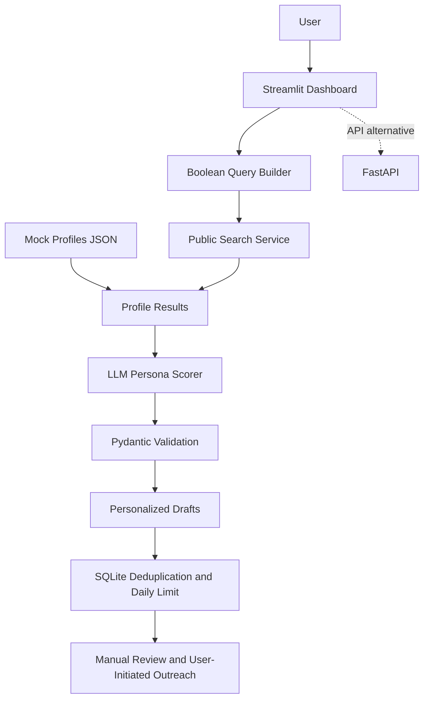

# LinkedIn Learner Discovery & Outreach Agent

A Python demo app for public-search X-ray queries, persona classification, personalized mentorship message drafts, and user-confirmed outreach tracking. It does not log into LinkedIn, scrape authenticated pages, or automatically send messages.

## Features
- Three persona buckets: `Fresher`, `1-2_YOE`, `Career_Switcher`
- Offline mode with 10 synthetic profiles
- Optional Serper public web-search integration
- Optional OpenAI-powered classification and message generation
- Pydantic validation for persona and message length limits
- Streamlit dashboard and FastAPI endpoints
- SQLite deduplication and daily limit (default 15)
- Nine synthetic sample outputs, three per persona

**Mock profile names and LinkedIn-style URLs are fictional placeholders. Do not use them for real outreach.**

## Architecture





## Setup (Windows PowerShell)
```powershell
py -m venv .venv
Set-ExecutionPolicy -Scope Process -ExecutionPolicy Bypass
.\.venv\Scripts\Activate.ps1
python -m pip install --upgrade pip
pip install -r requirements.txt
Copy-Item .env.example .env
streamlit run app/ui.py
```
Set `USE_MOCK_DATA=true` in `.env` to run without API keys. To enable live search, set `USE_MOCK_DATA=false` and add `SERPER_API_KEY`. To enable OpenAI generation, add `OPENAI_API_KEY` and optionally `OPENAI_MODEL`.

## FastAPI
```powershell
uvicorn app.main:app --reload
```
Open `/docs` on the local API server for interactive documentation.

## Safety and anti-ban approach
- No LinkedIn credentials, cookies, session tokens, authenticated scraping, or automated send actions.
- Search results come from a public search provider and are subject to that provider's terms and indexing.
- User reviews and edits messages and sends manually if appropriate.
- SQLite unique constraint prevents duplicate recorded URLs. The daily limit is checked transactionally.
- The limit is a guardrail, not a guarantee of platform-policy compliance. Follow LinkedIn terms, applicable privacy laws, search-provider terms, and recipient preferences.
- Do not infer sensitive traits or fabricate personal details.

## Tests
```powershell
pytest -q
```

## Project contents
- `app/ui.py`: Streamlit interface
- `app/main.py`: FastAPI endpoints
- `app/services/`: search, scoring, dispatch
- `app/models/profile.py`: Pydantic schemas
- `app/database/db.py`: SQLite tracking
- `app/utils/query_builder.py`: Boolean query generation
- `data/mock_profiles.json`: 10 synthetic profiles
- `sample_output.json`: 9 example payloads
